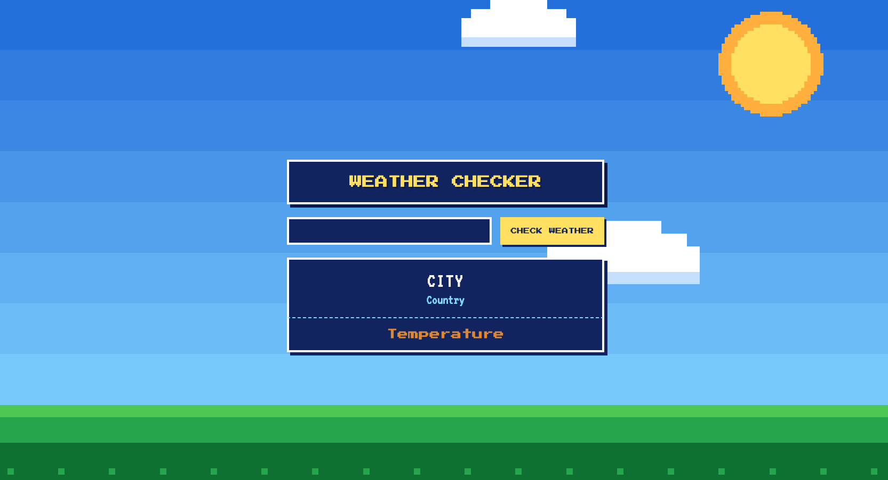
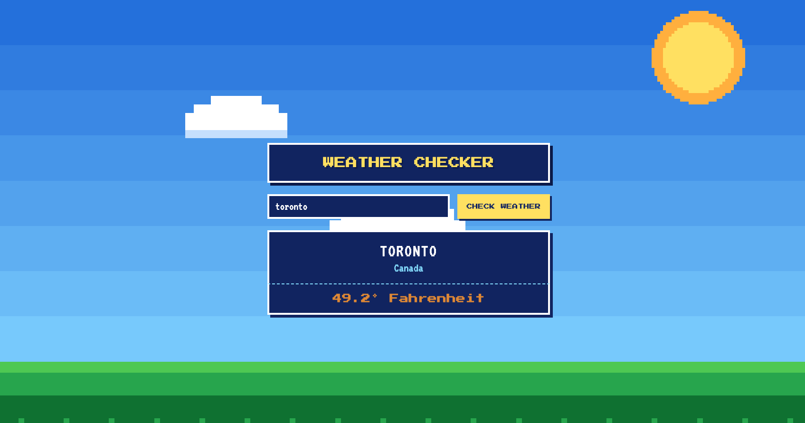

# 🌤️ Weather Checker

A small web app that looks up the current weather for any city. Type a city name, click **Check Weather**, and the page shows the city, the country and the temperature in °F. It has an 8-bit pixel look, with an animated pixel sky as the background.

[Visit Weather Checker](https://8bitweather.netlify.app/)

## ProjectPreview

## Goal

Build a small web app that uses `fetch` to pull live data from a public weather API and shows it on the page. The project practices working with APIs, promises and the DOM in vanilla JavaScript, then styling the result with plain CSS.

## 🛠️ Built with

- **HTML5**: a title, a search box and button, and three headings for the results
- **CSS3**: CSS Grid layout, Google Fonts (Press Start 2P and VT323), and an animated GIF as the page background
- **Vanilla JavaScript**: a click event listener, `fetch`, promises and DOM updates
- **[WeatherAPI.com](https://www.weatherapi.com/)**: the source of the weather data

## How it works

1. Type a city name into the search box.
2. Click **Check Weather**. The app reads the city from the input and builds a request URL for the WeatherAPI `current.json` endpoint.
3. `fetch` sends the request, and the response is converted to JSON.
4. The app writes the city name, the country and the temperature in Fahrenheit (`temp_f`) into the page.

## 📚 What I learned

- Making an API request with `fetch` and reading the JSON response
- Chaining `.then()` calls to handle a promise
- Building a request URL with a template literal
- Updating page content with `querySelector` and `innerText`
- Laying out a page with CSS Grid and using a GIF as a background image
